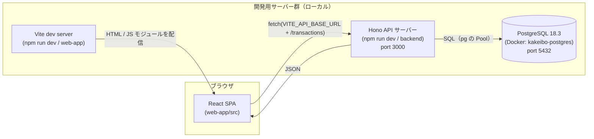

# システム全体像 — SPA と API サーバーの分離

## 概要

kakeibo-app（シンプル家計簿）は、**ブラウザで動く画面（フロントエンド）** と **データを返すサーバー（バックエンド）** を、別々のプログラムとして作る構成になっています。

- `web-app/` … React で作った **SPA（Single Page Application）**。画面の表示と操作を担当する。
- `backend/` … Hono で作った **API サーバー**。データの検証・計算・PostgreSQL への保存と読み出しを担当し、結果を **JSON** で返す。

両者は HTTP（`fetch` → JSON）だけでつながっており、お互いの内部実装を知りません。この「分離」が、このアプリの設計全体を理解する出発点です。

なぜ重要か:
- 画面の作り直し（デザイン変更・スマホアプリ化）をしても API はそのまま使える。
- API 側でデータベースを入れ替えても、画面側は JSON の形さえ変わらなければ影響を受けない。
- フロントとバックで担当者・デプロイ先・スケールのさせ方を分けられる。

## このプロジェクトでの実装

### 全体構成図



本番では、web-app（と学習ノート `/study/`）と backend をそれぞれ Vercel にデプロイし、DB は Neon の PostgreSQL を使う構成です（コミット `2a1609f` / `b00677a`、`web-app/vercel.json`）。backend は Vercel Functions 上で `export default app`（`backend/src/index.ts:108`）が直接使われ、ローカルでは `backend/src/dev.ts` が `@hono/node-server` で起動します。DB まわりは `../Docker/`・`../PostgreSQL/` を参照。

ポイント: **Vite dev server はアプリの JavaScript を配るだけ**で、API リクエストを中継（プロキシ）していません（`web-app/vite.config.ts` に `server.proxy` の設定はない）。ブラウザは Hono サーバーへ **直接** `fetch` します。オリジン（ポート）が違うので、バックエンド側で CORS を許可しています。

### それぞれの責務

| パッケージ | 主なファイル | 責務 |
|---|---|---|
| web-app | `web-app/src/App.tsx` | URL と画面（ページ）の対応付け（ルーティング） |
| web-app | `web-app/src/pages/*.tsx` | 画面単位の組み立て、フォーム入力の管理 |
| web-app | `web-app/src/components/*.tsx` | 表示部品 |
| web-app | `web-app/src/hooks/*.ts` | API 通信と、その結果（データ・読み込み中・エラー）の状態管理 |
| backend | `backend/src/index.ts` | DB 接続（Pool）、CORS、ルーティング、入力検証、SQL の実行、集計（合計）、レスポンス生成。`app` を export する |
| backend | `backend/src/dev.ts` | ローカル開発用の起動（dotenv で `.env` を読み、`serve` でポート 3000 で待ち受け） |
| backend | `backend/src/env.ts` | 環境変数（`FRONTEND_URL` / `DATABASE_URL`）の読み込みと検証 |
| DB | PostgreSQL（`transactions` テーブル） | データの保存。ローカルは Docker、本番は Neon（`../Database/`） |
| backend | `backend/openapi.yaml` | API の仕様書（契約） |

バックエンドのエンドポイントは現状 2 つだけです（`backend/src/index.ts:29`, `backend/src/index.ts:77`）。

```ts
// backend/src/index.ts:29
app.get("/transactions", async (c) => { ... });   // 一覧 + 件数 + 合計金額（SELECT）
// backend/src/index.ts:77
app.post("/transactions", async (c) => { ... });  // 1件登録（INSERT して id 付きで返す）
```

フロントの画面も 2 つです（`web-app/src/App.tsx:9-10`）。

```tsx
<Route path="/" element={<Home />} />        // 収入・支出の直近一覧
<Route path="/input" element={<Input />} />  // 登録フォーム
```

## 重要語句

- **SPA（Single Page Application）**: 最初に 1 枚の HTML と JS を読み込み、以降の画面遷移はブラウザ内の JS が DOM を書き換えて行うアプリ。`web-app/index.html:10` の `<div id="root">` に React が画面を描く。
- **API サーバー**: 画面ではなくデータ（JSON）を返すサーバー。
- **関心の分離（Separation of Concerns）**: 「表示」「通信」「検証」「保存」など性質の異なる関心事を、別の場所に置く設計原則。
- **クライアント / サーバー**: リクエストを送る側 / 応答する側。
- **オリジン**: スキーム + ホスト + ポートの組。違えば別オリジンで、ブラウザの CORS 制約がかかる。

## 仕様・注意点

- バックエンドは **PostgreSQL にデータを保存** します（ローカルは Docker、本番は Neon）。GET は `SELECT`、POST は `INSERT` してその結果を返します（詳細は `15-persistence-and-repository-layer.md`）。
- フロントとバックはリポジトリ内に並んでいますが、**ビルド・依存関係は完全に独立**しています（`03-repository-structure.md`）。
- 「分離」には代償もあります。API の仕様と TypeScript の型を両側で別々に管理する必要が生まれます（`14-api-contract-and-types.md`）。

## 今後に活かせるポイント

- 新しいアプリを作るとき、まず「画面（クライアント）」と「データ（API）」の境界を決め、その境界を **HTTP + JSON の契約** として明文化する（このプロジェクトでは `openapi.yaml`）。
- 境界が明確なら、片側だけを作り替える・モックに差し替えるといった作業が安全にできる。

## 改善するなら

- 開発時は Vite の `server.proxy` を使い、ブラウザからは同一オリジン（例: `/api/transactions`）でアクセスする方式もある。CORS 設定が開発時は不要になり、本番でも同一ドメイン配下に API を置けば CORS を避けられる。

```ts
// vite.config.ts の例（案）
export default defineConfig({
  plugins: [react()],
  server: {
    proxy: { "/api": { target: "http://localhost:3000", rewrite: (p) => p.replace(/^\/api/, "") } },
  },
});
```

ただし、現状の「直接アクセス + CORS」も本番で API を別ドメインに置く構成と近く、学習上は CORS を体験できる利点があります。詳細は Tooling / Hono フォルダ参照。

## 次に学ぶこと

- **BFF（Backend For Frontend）**: 画面ごとに最適化した API 層を挟む構成。
- **SSR / フルスタックフレームワーク**（React Router のフレームワークモード、Next.js など）: 画面とデータ取得を同じサーバーで扱う別の選択肢と、SPA + API 構成との比較。
