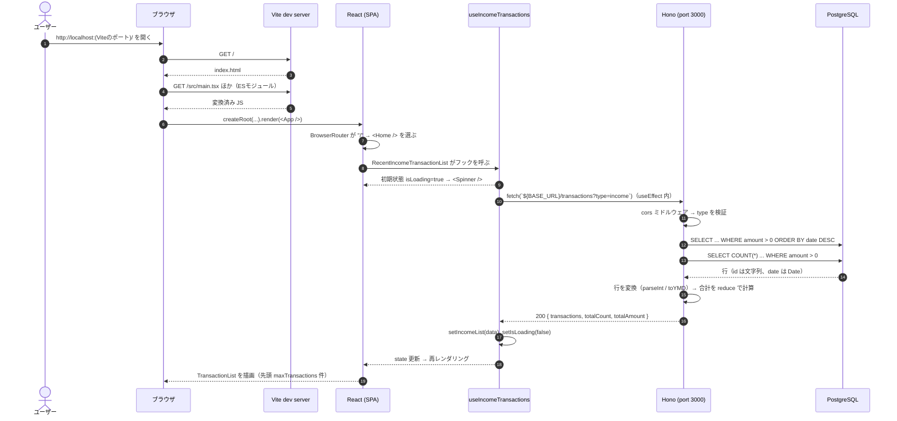
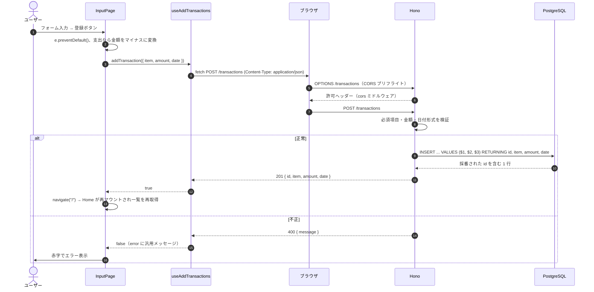

# リクエストの流れ — ブラウザから描画まで

## 概要

「画面に収入一覧が出る」までに、どのプログラムがどの順番で何をしているかを追います。流れを一度図にしておくと、バグが起きたときに「どの段階の問題か」を切り分けられるようになります。

## このプロジェクトでの実装

### 1. 一覧表示（GET）のシーケンス



対応するコード:

- エントリーポイント: `web-app/index.html:11` → `web-app/src/main.tsx:6`
- ルーティング: `web-app/src/App.tsx:9`
- フック呼び出し: `web-app/src/components/TransactionList.tsx:41`
- fetch: `web-app/src/hooks/useIncomeTransactions.ts:15`
- 取得開始のタイミング（マウント時に 1 回）: `web-app/src/hooks/useIncomeTransactions.ts:30-32`
- サーバー側処理: `backend/src/index.ts:29-75`（SQL の組み立て 41-51、実行 53-54、変換 56-61、合計 63-66）
- 状態に応じた表示切り替え: `web-app/src/components/TransactionList.tsx:85-108`

Home には収入と支出の 2 つのリストがあるので、**同じ流れが 2 本並行して** 走ります（`type=income` と `type=expense`）。

### 2. 登録（POST）のシーケンス



対応するコード:

- 送信処理: `web-app/src/pages/Input.tsx:29-47`
- fetch: `web-app/src/hooks/useAddTransactions.ts:14-18`
- CORS 設定: `backend/src/index.ts:12-20`
- 検証: `backend/src/index.ts:81-91`
- INSERT と成功レスポンス: `backend/src/index.ts:93-105`

`Content-Type: application/json` の POST はブラウザの「単純リクエスト」に当たらないため、実際の POST の前に OPTIONS によるプリフライトが送られます。`cors()` ミドルウェアは OPTIONS リクエストを自動で受け止めて 204 と許可ヘッダーを返します（`allowMethods` に `"OPTIONS"` を書かなくても応答します。`allowMethods` は `Access-Control-Allow-Methods` ヘッダーに載せる値の指定です）（CORS の詳細は Hono / API-Design フォルダ参照）。

## 重要語句

- **シーケンス図**: 登場人物（参加者）の間のメッセージのやり取りを時間順に描く図。
- **マウント**: コンポーネントが初めて画面に配置されること。`useEffect(..., [])` はマウント後に実行される。
- **プリフライトリクエスト**: クロスオリジンで「単純でない」リクエストを送る前に、ブラウザが自動で送る OPTIONS リクエスト。
- **再レンダリング**: state が変わったときに React がコンポーネント関数を再実行し、画面を更新すること。

## 仕様・注意点

- 開発時は `<StrictMode>`（`web-app/src/main.tsx:7`）により、マウント時の Effect が意図的に 2 回実行されます。そのため開発中はネットワークタブで GET が 2 回ずつ見えるのが正常です（本番ビルドでは 1 回）。
- 登録後に一覧が更新されるのは、POST の結果を state に反映しているからではなく、**画面遷移で Home が作り直され、フックが再度 fetch するから** です（`10-state-management.md`）。
- 本番では Vite dev server は存在せず、Vercel が `npm run build && npm run build:study`（`web-app/vercel.json:3`）で生成した `dist/` を静的に配信します。バックエンドも Vercel にデプロイされ、`backend/src/index.ts` の `export default app`（108 行目）が Vercel Functions として実行されます（ローカル用の `serve` は `backend/src/dev.ts` に分離。`backend/package.json` のスクリプトは `dev` と `typecheck` のみ）。DB は本番では Neon です（`../PostgreSQL/08-neon-and-vercel-attach-database-pool.md`）。

## 今後に活かせるポイント

- 不具合調査は「ブラウザのネットワークタブ → サーバーログ（DB のエラーを含む）→ フックの state → コンポーネント」の順にこの図をなぞると切り分けやすい。
- 新機能を設計するときも、まずシーケンス図を描くと「どこで検証するか」「どこで state を持つか」が自然に決まる。

## 改善するなら

- サーバー側にリクエストログを入れると流れを追いやすくなります（Hono には `logger` ミドルウェアがある。Hono フォルダ参照）。

```ts
import { logger } from "hono/logger";
app.use(logger());
```

## 次に学ぶこと

- ブラウザ DevTools の Network パネルの読み方（Timing、Preflight の表示）。
- **分散トレーシング**（OpenTelemetry）: 複数サービスにまたがるリクエストの流れを可視化する仕組み。
