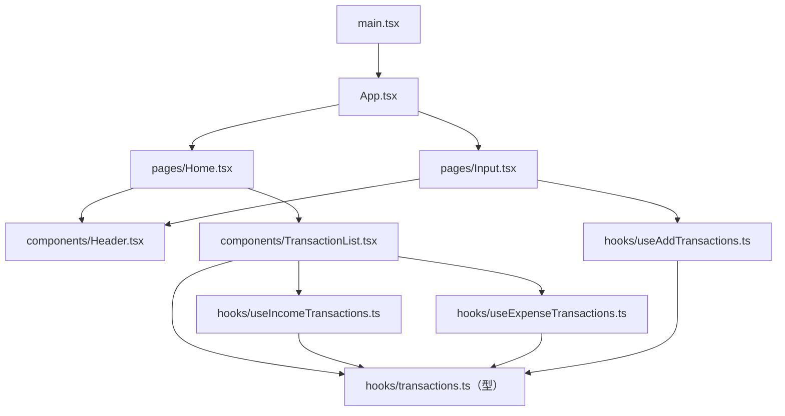

# フロントエンドのレイヤー分け — pages / components / hooks / 型

## 概要

`web-app/src/` は「役割ごと」にフォルダが分かれています。ファイルを置く場所のルールが決まっていると、コードを読む人は「画面の構成を見たいなら pages」「通信を直したいなら hooks」とすぐに辿り着けます。これが **関心の分離** をディレクトリで表現したものです。

## このプロジェクトでの実装

```text
web-app/src/
├── main.tsx                ← 起動：React を DOM に接続、Provider を設定
├── App.tsx                 ← ルーティング：URL → ページ
├── pages/                  ← 画面単位（URL 1 つにつき 1 ファイル）
│   ├── Home.tsx            ← "/"      一覧画面（SummaryCard もここに同居）
│   └── Input.tsx           ← "/input" 登録フォーム
├── components/             ← 画面をまたいで使える部品
│   ├── Header.tsx          ← 全画面共通のヘッダー
│   └── TransactionList.tsx ← 取引一覧（4 階層のコンポーネント）
└── hooks/                  ← データ取得・送信のロジック
    ├── transactions.ts     ← 型定義のみ（Transaction など）
    ├── useIncomeTransactions.ts
    ├── useExpenseTransactions.ts
    └── useAddTransactions.ts
```

### 依存の向き



矢印は「import している」方向です。**上位（画面）が下位（部品・ロジック・型）に依存し、逆向きの依存はありません**。型定義ファイルはどこにも依存しない最下層です。

### 各レイヤーの責務

| レイヤー | 責務 | 例 |
|---|---|---|
| main / App | アプリ全体の初期化、ルーティング | `web-app/src/main.tsx:6-12`, `web-app/src/App.tsx:5-14` |
| pages | 画面のレイアウト、画面固有の state（フォーム入力）、画面遷移 | `web-app/src/pages/Input.tsx:20-24`（入力 state）, `:45`（遷移） |
| components | 受け取ったデータの表示 | `web-app/src/components/Header.tsx`, `TransactionList.tsx` |
| hooks | API 通信、loading / error / data の状態管理 | `web-app/src/hooks/useIncomeTransactions.ts:5-40` |
| 型（transactions.ts） | データの「形」の定義、フックの戻り値の約束 | `web-app/src/hooks/transactions.ts:1-27` |

型定義ファイルの中身（`web-app/src/hooks/transactions.ts`）:

```ts
export type Transaction = { id: number; item: string; amount: number; date: string };       // :1-6
export type TransactionListInfo = { transactions: Transaction[]; totalCount: number; totalAmount: number }; // :8-12
export type TransactionsHooks = { transactionList: TransactionListInfo | undefined; isLoading: boolean; error: Error | null; refetch: () => void }; // :14-19
export type NewTransaction = Omit<Transaction, "id">;                                       // :21
export type AddTransactionHooks = { addTransaction: (t: NewTransaction) => Promise<boolean>; isLoading: boolean; error: Error | null }; // :23-27
```

ここには 2 種類の型が混ざっています。

1. **ドメインの型**: `Transaction`, `NewTransaction`, `TransactionListInfo`（API の JSON の形でもある）
2. **フックのインターフェース型**: `TransactionsHooks`, `AddTransactionHooks`（フックが UI に約束する戻り値）

フックのインターフェースを型として先に決めているので、収入用・支出用のフックが **同じ形の戻り値** を返すことが保証され、`RecentTransactionList` がどちらのフックの結果も受け取れます（`web-app/src/components/TransactionList.tsx:74-76`）。

## 重要語句

- **レイヤー（層）**: 役割ごとにコードを分けた段。上の層が下の層を使う。
- **依存の向き**: どのモジュールがどのモジュールを import しているか。一方向に保つと変更の影響範囲が読みやすい。
- **関心の分離**: 表示・状態・通信などを別の場所に置くこと。
- **インターフェース（契約）**: 中身の実装ではなく「何を受け取り何を返すか」の約束。TypeScript では `type` / `interface` で表す。

## 仕様・注意点

- **型定義が `hooks/` の中にある**: `Transaction` はフック専用ではなくアプリ全体のドメイン型です。`components/TransactionList.tsx:14` が `../hooks/transactions` から型を import しており、「部品がフックのフォルダに依存している」ように見えます。
- **`SummaryCard` は `pages/Home.tsx:59-68` に同居** しています。Home でしか使わないうちはこれで問題ありません（使う場所の近くに置く＝コロケーション）。
- **import パスの書き方が混在**: `Home.tsx:15` は相対パス `../components/TransactionList`、`Home.tsx:16` はエイリアス `@/components/Header`。エイリアスは `tsconfig.app.json:10-12` の `paths` と `vite.config.ts:8` の `resolve.tsconfigPaths` で有効化されています（Tooling フォルダ参照）。どちらかに統一すると読みやすくなります。
- ファイル名の規則: `Input.tsx` の中の関数名は `InputPage`（`web-app/src/pages/Input.tsx:19`）で、Chakra UI の `Input` コンポーネントとの名前衝突を避けています。

## 今後に活かせるポイント

- 「pages / components / hooks / types」の 4 分割は React プロジェクトで最もよく見る出発点。まずはこれで始め、規模が大きくなったら機能単位（feature）に再編する。
- **フックの戻り値を型で先に決める** と、実装の差し替え（モック化、TanStack Query への移行など）をしても UI 側を変えずに済む。

## 改善するなら

型をドメイン型として独立させ、API 呼び出しも分けた構成の例です。

```text
web-app/src/
├── types/
│   └── transaction.ts      ← Transaction, NewTransaction, TransactionListInfo
├── api/
│   └── transactions.ts     ← fetchTransactions(type), createTransaction(input)（純粋な通信関数）
├── hooks/
│   ├── types.ts            ← TransactionsHooks などフックの戻り値型
│   ├── useTransactions.ts
│   └── useAddTransaction.ts
├── components/
└── pages/
```

規模が大きくなったら **feature-based** 構成も検討します。

```text
web-app/src/
├── features/
│   └── transactions/
│       ├── api.ts
│       ├── types.ts
│       ├── hooks/
│       └── components/
├── components/   ← 機能を問わない汎用部品（Header など）
└── pages/
```

## 次に学ぶこと

- **Feature-based / Bulletproof React** 風のディレクトリ構成。
- **コロケーション**: 関係するファイル（コンポーネント・テスト・スタイル）を近くに置く考え方。
