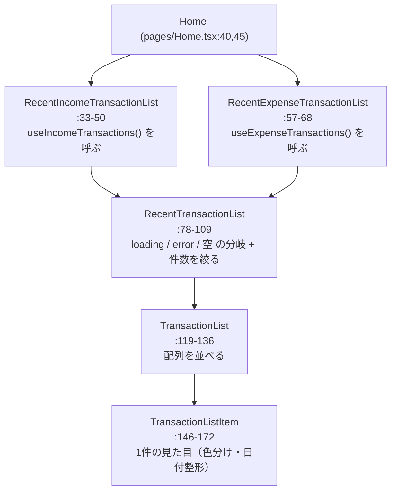

# コンポーネント分割 — Container / Presentational の考え方

## 概要

`web-app/src/components/TransactionList.tsx` には、取引一覧を表示するために **4 段階のコンポーネント** が入っています。上の段ほど「データの出どころ」を知っていて、下の段ほど「見た目」だけに集中しています。これは古くから知られる **Container / Presentational パターン** と同じ発想です。

## このプロジェクトでの実装

### 4 階層の構造



| コンポーネント | 何を知っているか | 役割分類 |
|---|---|---|
| `RecentIncomeTransactionList` / `RecentExpenseTransactionList` | どのフックからデータを取るか | **Container**（データ供給） |
| `RecentTransactionList` | フックの戻り値の形（`TransactionsHooks`）、表示件数 | 状態 → 表示の **振り分け役** |
| `TransactionList` | `Transaction[]` だけ | **Presentational** |
| `TransactionListItem` | `Transaction` 1 件だけ | **Presentational** |

### コードで見る責務の差

Container（`web-app/src/components/TransactionList.tsx:57-68`）— 使うフックを決めるだけ:

```tsx
export const RecentExpenseTransactionList = ({ maxTransactions }: RecentTransactionListProps) => {
  const expenseTransactions = useExpenseTransactions();
  return <RecentTransactionList hooks={expenseTransactions} maxTransactions={maxTransactions} />;
};
```

振り分け役（`:78-109`）— 状態に応じて何を出すか:

```tsx
const { transactionList, isLoading, error } = hooks;
if (isLoading) return <Spinner />;
if (error) return <Text color="red.500">{error.message}</Text>;
if (!transactionList?.transactions.length) return <Text>取引はまだありません。</Text>;
const recentTransactions = transactionList.transactions.slice(0, maxTransactions);
return <TransactionList transactions={recentTransactions} />;
```

Presentational（`:119-136`, `:146-172`）— props で受け取ったデータを描くだけ。フックも fetch も出てきません。

### 公開範囲（export）による設計

`export` されているのは `RecentIncomeTransactionList` と `RecentExpenseTransactionList` の 2 つだけ（`:33`, `:57`）。`RecentTransactionList` / `TransactionList` / `TransactionListItem` / `formatDate` はファイル内に閉じています（`:118` のコメント参照）。外から見ると「最近の収入一覧」「最近の支出一覧」という使いやすい部品だけが見え、内部構造は自由に変えられます。これを **カプセル化** と呼びます。

## 重要語句

- **Container コンポーネント**: データの取得・状態管理を担い、見た目は子に任せるコンポーネント。
- **Presentational コンポーネント**: props だけを受け取り、見た目を描くことに専念するコンポーネント。同じ props なら同じ表示になる（純粋）。
- **単一責任の原則**: 1 つのコンポーネントは 1 つの理由でだけ変わるべき。「データの取り方が変わった」「見た目が変わった」で直す場所が分かれる。
- **カプセル化**: 内部の実装を隠し、外に公開するものを最小限にすること。
- **合成（composition）**: 小さなコンポーネントを組み合わせて大きな UI を作る React の基本思想。

## 仕様・注意点

- フックが普及した現在、React 公式は Container / Presentational の厳密な区別を必須とはしていません。ただ「データ取得を上位に寄せ、末端は props だけで描く」という考え方は今も有効で、テストしやすさ・再利用しやすさに直結します。
- `RecentTransactionList` は `hooks` という名前の prop でフックの **戻り値（オブジェクト）** を受け取っています（`:75`）。フックそのもの（関数）を渡しているわけではない点に注意。prop 名としては `result` や `query` のほうが誤解が少ないかもしれません。
- 件数の絞り込み（`slice(0, maxTransactions)`、`:102-105`）はフロントで行っています。サーバーは全件を返す前提なので、件数が増えると無駄な転送になります（`17-roadmap.md`）。
- 「直近」と言いつつ日付順の並べ替えはしていません。サーバーが返した順の先頭 N 件です。
- `TransactionListItem` の色分け `transaction.amount > 0 ? "green.500" : "red.500"`（`:165`）は、金額の符号が収支を表すというドメインルールに依存しています（`09-domain-modeling-signed-amount.md`）。

## 今後に活かせるポイント

- 一覧 UI を作るときは「データ供給」「状態の振り分け」「リスト」「アイテム」の 4 段を意識すると、どこに何を書くか迷わない。
- Presentational な部品は Storybook やテストで **props を渡すだけで確認できる** ので、デザイン調整が楽になる。
- `export` を絞って「公開 API」を小さく保つと、ファイル内部のリファクタリングが安全になる。

## 改善するなら

Container が 2 つに分かれているのは「使うフックが違うだけ」なので、フックを 1 つにまとめれば Container も 1 つにできます（`08-dry-and-duplication.md`）。

```tsx
// 案: type を props で受け取る 1 つの Container
type Props = { type: "income" | "expense"; maxTransactions: number };

export const RecentTransactions = ({ type, maxTransactions }: Props) => {
  const result = useTransactions(type);
  return <TransactionListView result={result} maxTransactions={maxTransactions} />;
};

// Home.tsx 側
<RecentTransactions type="income" maxTransactions={3} />
```

また、`formatDate` のような純粋関数は `utils/date.ts` に移すと単体テストしやすくなります。

## 次に学ぶこと

- **Storybook**: Presentational コンポーネントをカタログ化して単独で確認するツール。
- **Compound Components / Render Props / Headless UI**: より柔軟な部品設計パターン（Chakra UI v3 の `Card.Root` / `Card.Header` も Compound Components の一種。ChakraUI フォルダ参照）。
