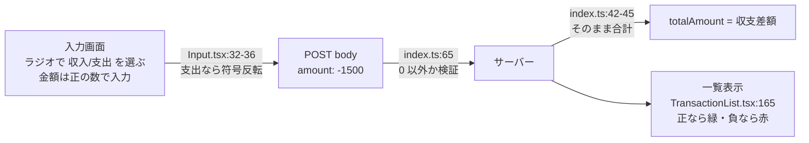

# ドメインモデリング — 支出を「マイナスの金額」で表す設計

## 概要

家計簿の中心となるデータ（ドメインモデル）は「取引（Transaction）」です。このプロジェクトでは取引を `{ id, item, amount, date }` の 4 項目で表し、**収入か支出かを専用の項目で持たず、`amount` の符号（プラス = 収入、マイナス = 支出）で表現** しています。

この選択はシンプルで便利な反面、いくつかの落とし穴があります。データの表し方は後から変えるのが最も大変な部分なので、メリット・デメリットを理解しておくことが重要です。

## このプロジェクトでの実装

### モデルの定義

```ts
// web-app/src/hooks/transactions.ts:1-6
export type Transaction = {
  id: number;
  item: string;
  amount: number;  // 符号で収入/支出を表す
  date: string;    // "YYYY-MM-DD"
};
```

OpenAPI でも `amount` は「0 以外の数値」です（`backend/openapi.yaml:107-112`）。

```yaml
amount:
  type: number
  not:
    const: 0
  description: 金額（0以外の数値）
```

### 符号ルールが現れる 4 か所



**1. 入力時の符号変換**（`web-app/src/pages/Input.tsx:32-36`）

```ts
let adjustAmount = Number(amount);

if (transactionType === "expense" && adjustAmount > 0) {
  adjustAmount = -adjustAmount;
}
```

ユーザーには「正の金額 + 種別（ラジオボタン）」で入力させ、送信直前に **UI の表現（種別 + 正の数）からドメインの表現（符号付きの数）へ変換** しています。

**2. サーバーでの検証**（`backend/src/index.ts:65`）: `amount === 0` だけを拒否。符号はどちらも許可。

**3. 合計計算**（`backend/src/index.ts:42-45`）: 全件の `amount` を単純に `reduce` で足すだけで、**収入 − 支出 = 収支差額** が求まる。符号表現の最大の利点です。

**4. 表示の色分け**（`web-app/src/components/TransactionList.tsx:164-169`）

```tsx
<Text color={transaction.amount > 0 ? "green.500" : "red.500"} fontWeight="bold">
  {transaction.amount.toLocaleString()}円
</Text>
```

`toLocaleString()` は負の数に自動で `-` を付けるので、支出は「-1,500円」と表示されます。

## 重要語句

- **ドメイン**: ソフトウェアが扱う業務領域（ここでは家計管理）。
- **ドメインモデル**: ドメインの概念をデータ構造として表したもの。
- **暗黙のルール（implicit convention）**: 型やスキーマに書かれておらず、コードの各所の「お約束」で成り立っているルール。符号 = 種別はその例。
- **判別可能なユニオン（discriminated union）**: `type: "income" | "expense"` のような共通フィールドで種類を見分ける TypeScript の型の書き方（TypeScript フォルダ参照）。
- **値オブジェクト（Value Object）**: 金額など「値そのもの」に意味とルールを持たせた小さな型。

## 仕様・注意点

### メリット

- 項目が少なく、モデルがシンプル。
- 合計（収支差額）が単純な足し算で求まる。
- 1 つの配列・1 つのエンドポイントで収入と支出をまとめて扱える。

### デメリット・現状の問題点

- **ルールが暗黙**: `Transaction` 型を見ても「負なら支出」とは分からない。フロント・バック・OpenAPI の各所が同じお約束を守る必要がある。
- **バックエンドは種別を区別していない**: GET の `type=income/expense` で絞り込むには `amount > 0` / `< 0` で判定することになるが、現状は絞り込み自体が未実装（`backend/src/index.ts:30-37`）。
- **入力の抜け道**: 符号反転は `transactionType === "expense" && adjustAmount > 0` のときだけ。「収入」を選んで負の値を送ると支出として保存されうる。HTML の `min={0}`（`Input.tsx:100`）で通常のフォーム送信は防がれるが、API を直接叩けば防げない。
- **0 の扱い**: HTML の `min={0}` は 0 を許可するが、サーバーは 0 を拒否する（`backend/src/index.ts:65`）。0 を入力すると 400 になり、画面には汎用メッセージ「取引の登録に失敗しました。」だけが出る（`11-error-handling-strategy.md`）。
- **「収入合計」「支出合計」を別々に出すには** 符号でフィルタしてから足す必要があり、`totalAmount` の意味がクエリ（`type`）によって変わる（income なら収入合計、all なら差額）。
- **浮動小数点**: `amount` は `number`（OpenAPI でも `type: number`）なので、API としては小数も受け付ける（フォームの `type="number"` は既定の `step` が 1 なので通常の画面操作では整数に限られるが、サーバーは検証していない）。日本円なら整数に限定するほうが安全。

## 今後に活かせるポイント

- **UI の表現とドメインの表現は違ってよい**。入力しやすい形（種別 + 正の数）で受け取り、境界で変換する、という今回のやり方自体は良いパターン。
- ただし変換ルールは **1 か所（関数）にまとめ、型やスキーマで明文化** するのが理想。
- データモデルを決めるときは「合計・絞り込み・表示」の 3 つのユースケースで試算してみると、どちらの表現が楽か判断しやすい。

## 改善するなら

### 案 A: 符号表現を維持し、ルールを関数に閉じ込める

```ts
// domain/transaction.ts（案）
export type TransactionKind = "income" | "expense";

export const toSignedAmount = (kind: TransactionKind, absAmount: number) =>
  kind === "expense" ? -Math.abs(absAmount) : Math.abs(absAmount);

export const kindOf = (t: { amount: number }): TransactionKind =>
  t.amount < 0 ? "expense" : "income";
```

`Math.abs` を使えば「収入で負の値」の抜け道も塞げます。色分けも `kindOf(t) === "income"` と書けば意図が明確になります。

### 案 B: `type` フィールドを持ち、金額は常に正にする

```ts
export type Transaction = {
  id: number;
  type: "income" | "expense";
  item: string;
  amount: number; // 常に正の整数
  date: string;
};
```

```yaml
# openapi.yaml（案）
type:
  type: string
  enum: [income, expense]
amount:
  type: integer
  minimum: 1
```

- 利点: ルールが明示的、GET の絞り込みが `type` の一致で書ける、DB でもインデックスを張りやすい、入力の抜け道がない。
- 欠点: 合計計算で `type` を見て符号を付ける処理が必要、項目が 1 つ増える。

一般的な家計簿・会計システムでは **案 B（種別を明示）** が多く採用されます。カテゴリ（食費・交通費など）を追加する将来を考えても、種別を明示しておくほうが拡張しやすいでしょう。

## 次に学ぶこと

- **ドメイン駆動設計（DDD）** の入門: エンティティ、値オブジェクト、ユビキタス言語。
- **お金の扱い**: 浮動小数点誤差を避けるため整数（最小通貨単位）で持つ、Money 型を作る、といった定石。
