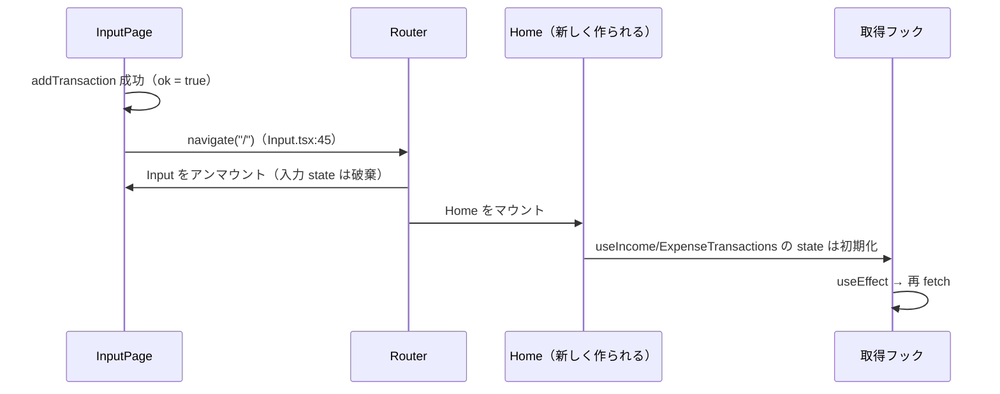

# 状態管理の方針 — ローカル state だけで作る

## 概要

このアプリは Redux や Zustand のようなグローバル状態管理ライブラリも、React Context も使っていません。**すべての状態は `useState` によるコンポーネントローカルの state** です。

小さなアプリではこれが最もシンプルで正しい選択です。ただし、状態には性質の違う 2 種類 ——「**サーバー状態**」と「**クライアント状態**」—— があり、それを区別して考えると、今後どこで困るか・何を導入すべきかがはっきりします。

## このプロジェクトでの実装

### アプリ内の state 一覧

| 場所 | state | 種類 |
|---|---|---|
| `web-app/src/hooks/useIncomeTransactions.ts:6-8` | `incomeList`, `isLoading`, `error` | サーバー状態（のコピー）+ 通信状態 |
| `web-app/src/hooks/useExpenseTransactions.ts:6-8` | `expenseList`, `isLoading`, `error` | サーバー状態（のコピー）+ 通信状態 |
| `web-app/src/hooks/useAddTransactions.ts:6-7` | `isLoading`, `error` | 通信状態 |
| `web-app/src/pages/Input.tsx:20-24` | `transactionType`, `item`, `amount`, `date` | クライアント状態（フォーム入力） |
| URL（React Router） | `/` or `/input` | どの画面か（URL が状態を持つ） |

```tsx
// web-app/src/pages/Input.tsx:20-24 — フォームの入力値（クライアント状態）
const [transactionType, setTransactionType] = useState<TransactionType>("expense");
const [item, setItem] = useState("");
const [amount, setAmount] = useState("");
const [date, setDate] = useState("");
```

### 「登録後に一覧が更新される」仕組み



`/input` から `/` に戻ると Home が **新しくマウント** され、フックの state も初期化されて再取得が走ります。つまり、

- 登録結果を一覧の state に直接反映するコード（`setIncomeList` など）は **ない**
- `refetch`（`useIncomeTransactions.ts:38`）も **使われていない**
- 「毎回取り直す」ことで、サーバーとの整合性を単純に保っている

という設計です。

## 重要語句

- **ローカル state**: 1 つのコンポーネント（とその中のフック）だけが持つ状態。`useState` で作る。
- **グローバル state**: アプリのどこからでも参照できる状態。Context、Zustand、Redux などで実現。
- **サーバー状態（server state）**: 本当の持ち主がサーバーにあり、フロントは「ある時点のコピー」を持っているだけのデータ（取引一覧など）。古くなる・他の人が変更する・取得に時間がかかる、という性質がある。
- **クライアント状態（client state）**: ブラウザの中だけで完結するデータ（フォーム入力、モーダルの開閉、選択中のタブなど）。
- **state の持ち上げ（lifting state up）**: 複数のコンポーネントで共有する state を共通の親に移すこと。
- **キャッシュ無効化（invalidation）**: 「このデータは古くなった」と印をつけて再取得させること。

## 仕様・注意点

- **同じデータを複数回取得する**: Home を開くたびに必ず通信が発生し、キャッシュはありません。前回のデータを一瞬表示しておく、といった工夫もできません（毎回 `<Spinner />` から始まる）。
- **同じサーバー状態が別々のコピーになる**: 今は収入と支出で別リクエストなので問題になりませんが、将来「ヘッダーに残高」「Home に一覧」のように同じデータを 2 か所で使うと、それぞれのフックが別々に取得し、更新タイミングがずれる可能性があります。
- **フォームの state はページ遷移で消える**: キャンセル（`Input.tsx:49-51`）で戻ると入力内容は破棄されます。これは仕様として自然です。
- 開発時は StrictMode により各フックの初回取得が 2 回走ります（`02-request-flow.md`）。
- 現状 Context を使っているのは Chakra UI の `ChakraProvider`（`web-app/src/main.tsx:8`）と React Router の `BrowserRouter`（`web-app/src/App.tsx:7`）だけで、いずれもライブラリ内部のためのものです。

## 今後に活かせるポイント

- まずはローカル state で始め、**本当に共有が必要になったら** 持ち上げ → Context → 専用ライブラリ、と段階的に進めるのが定石。
- 状態を追加するときは「これはサーバー状態か、クライアント状態か」を最初に問う。
  - サーバー状態 → TanStack Query などの **サーバー状態管理ライブラリ** に任せる。
  - クライアント状態 → `useState` / URL（検索条件など）/ 必要なら Zustand。
- 「迷ったら再取得」は正しさを保つ最も簡単な戦略。性能が問題になってからキャッシュを考えればよい。

## 改善するなら

### 段階 1: 自作フックのまま `refetch` を活用

同一画面内で登録できる UI（モーダルなど）にした場合、`navigate` に頼れないので `refetch` を呼んで更新します。

```tsx
const income = useIncomeTransactions();
const { addTransaction } = useAddTransactions();

const onSubmit = async (input: NewTransaction) => {
  if (await addTransaction(input)) income.refetch();
};
```

### 段階 2: TanStack Query でサーバー状態を一元管理

```tsx
// 取得（キャッシュキーで同じデータを共有）
const income = useQuery({
  queryKey: ["transactions", "income"],
  queryFn: () => fetchTransactions("income"),
});

// 登録 → 関連キャッシュを無効化して自動再取得
const queryClient = useQueryClient();
const add = useMutation({
  mutationFn: createTransaction,
  onSuccess: () => queryClient.invalidateQueries({ queryKey: ["transactions"] }),
});
```

loading / error / data の管理、重複リクエストの排除、画面復帰時の再取得などがライブラリ側で行われ、今の自作フックの大部分が不要になります。

## 次に学ぶこと

- **TanStack Query** の基本（`queryKey`、`staleTime`、`invalidateQueries`）。
- **Zustand / Jotai**: 軽量なクライアント状態管理。
- **URL を状態として使う**: 絞り込み条件や月の切り替えを `?month=2025-01` のように URL に持たせる設計（Routing フォルダ参照）。
