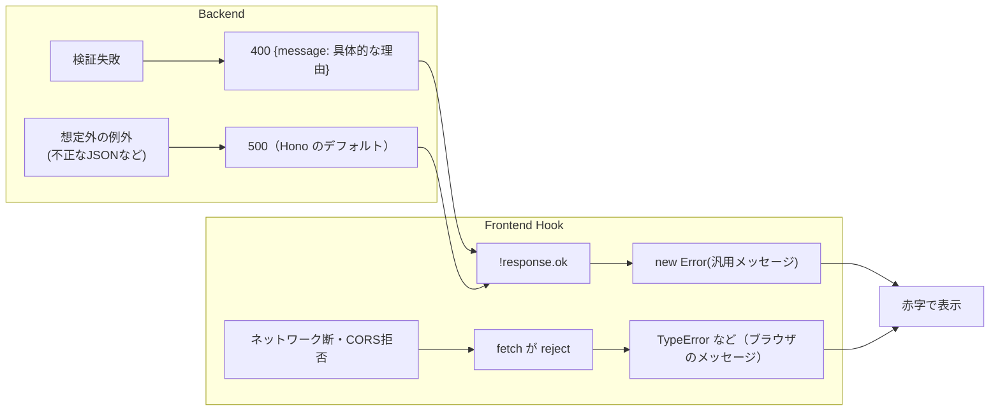

# エラーハンドリングの全体戦略

## 概要

エラー処理は「どこで検出し」「どう伝え」「どこで表示するか」を、フロントとバックをまたいで一貫させる必要があります。このプロジェクトでは、

- バックエンドは **HTTP 400 + `{ message }`** で具体的な理由を返す
- フロントエンドは **ステータスが ok でなければ、自前の汎用メッセージ** を表示する

という分担になっており、**サーバーが返した具体的なメッセージはユーザーに届いていません**。この現状と改善方法を整理します。

## このプロジェクトでの実装

### バックエンド: 理由付きの 400

```ts
// backend/src/index.ts:21-28
if (!type || !["income", "expense", "all"].includes(type)) {
  return c.json({ message: "typeはincome,expense,allのいずれかである必要があります。" }, 400);
}
```

POST では 3 種類のエラーを返し分けています（`backend/src/index.ts:56-81`）。

| 条件 | message |
|---|---|
| `item` / `amount` / `date` のどれかが欠けている | 必須項目が不足しています。 |
| `amount` が数値でない、または 0 | 金額は0以外の数値である必要があります。 |
| `date` が `YYYY-MM-DD` でない | 日付はYYYY-MM-DD形式で入力してください。 |

エラーの形は OpenAPI の `ErrorResponse`（`backend/openapi.yaml:153-160`）として契約化されています。

### フロントエンド: 汎用メッセージに置き換え

```ts
// web-app/src/hooks/useAddTransactions.ts:19-27
if (!response.ok) {
  throw new Error("取引の登録に失敗しました。");   // サーバーの message は読んでいない
}
...
} catch (err) {
  setError(err instanceof Error ? err : new Error("不明なエラーが発生しました。"));
  return false;
}
```

表示側:

```tsx
// web-app/src/pages/Input.tsx:111
{error && <Text color="red.500">{error.message}</Text>}

// web-app/src/components/TransactionList.tsx:90-92
if (error) {
  return <Text color="red.500">{error.message}</Text>;
}
```

### エラーの流れ



### フロントで起こりうるエラーの分類

| 種類 | 発生箇所 | 今の表示 |
|---|---|---|
| 4xx（入力ミスなど） | `response.ok === false` | 汎用メッセージ |
| 5xx（サーバーの不具合） | `response.ok === false` | 同じ汎用メッセージ |
| ネットワークエラー / CORS 拒否 | `fetch` 自体が reject | ブラウザ由来の英語メッセージ（例: `Failed to fetch`）がそのまま出る |
| JSON の解析失敗 | `response.json()` が reject | 解析エラーのメッセージがそのまま出る |

## 重要語句

- **ステータスコード**: 2xx 成功、4xx クライアント側の問題、5xx サーバー側の問題（API-Design フォルダ参照）。
- **エラーレスポンスの契約**: エラー時の JSON の形を固定すること（ここでは `{ message }`）。
- **ユーザー向けメッセージ / 開発者向けメッセージ**: 表示してよい分かりやすい文言と、ログに残す詳細情報は分けて考える。
- **グローバルエラーハンドラ**: 個々のハンドラで捕まえ損ねた例外をまとめて処理する仕組み（Hono の `app.onError`、React の Error Boundary）。
- **`fetch` の仕様**: HTTP エラー（404, 500 など）では reject **されない**。reject されるのはネットワーク障害などで通信自体が完了しなかったときだけ。

## 仕様・注意点

- **ユーザーは何を直せばよいか分からない**: 例えば金額に 0 を入れると、サーバーは「金額は0以外の数値である必要があります。」と返しますが、画面には「取引の登録に失敗しました。」しか出ません。
- **4xx と 5xx を区別していない**: 「入力を直せば通る」のか「時間をおいて再試行すべき」なのかが伝わりません。
- **技術的なメッセージがそのまま出ることがある**: `fetch` の reject はブラウザのメッセージがそのまま `error.message` になり、ユーザー向けとしては不親切です。
- **バックエンドに共通のエラーハンドラがない**: `c.req.json()`（`backend/src/index.ts:52`）が不正な JSON で例外を投げると、`{ message }` 形式ではない 500 応答になり、OpenAPI の契約（400 + ErrorResponse）から外れます。
- 汎用メッセージを出す現状にも利点はあります。サーバーの内部情報を誤って表示する心配がなく、サーバーのメッセージ文言の変更に UI が左右されません。「**サーバーの message はユーザー向けに書かれている**」という合意を契約に含めるなら、活用してよいでしょう。

## 今後に活かせるポイント

- エラー処理は **境界ごとに責任を決める**: サーバーは「機械的に判別できるコード + 人が読める message」を返し、クライアントは「どれを表示するか」を決める。
- 「通信できなかった」「サーバーが拒否した（4xx）」「サーバーが壊れた（5xx）」の 3 分類で UI の文言を分けると、ユーザーにとって分かりやすい。
- エラーの形（JSON の構造）は成功レスポンスと同じく **API 仕様の一部** として扱う。

## 改善するなら

### フロント: サーバーの message を活かす共通関数

```ts
// lib/apiClient.ts（案）
// ※ tsconfig.app.json:25 で erasableSyntaxOnly が有効なので、
//   constructor(public status: number) のような「パラメータプロパティ」は使えない。
//   フィールドを明示的に宣言する。
export class ApiError extends Error {
  status: number;
  constructor(message: string, status: number) {
    super(message);
    this.status = status;
  }
}

export async function apiFetch<T>(path: string, fallback: string, init?: RequestInit): Promise<T> {
  let res: Response;
  try {
    res = await fetch(`${BASE_URL}${path}`, init);
  } catch {
    throw new Error("サーバーに接続できませんでした。通信環境を確認してください。");
  }
  if (!res.ok) {
    const body = await res.json().catch(() => null);
    const message =
      res.status < 500 && typeof body?.message === "string"
        ? body.message            // 4xx はサーバーの理由を表示
        : fallback;               // 5xx は汎用メッセージ
    throw new ApiError(message, res.status);
  }
  return (await res.json()) as T;
}
```

### バック: 共通エラーハンドラでエラー形式を統一

```ts
// backend（案）
app.onError((err, c) => {
  console.error(err);
  return c.json({ message: "サーバーでエラーが発生しました。" }, 500);
});

app.notFound((c) => c.json({ message: "見つかりません。" }, 404));
```

### さらに進めるなら: 機械可読なエラーコード

```json
{ "code": "INVALID_AMOUNT", "message": "金額は0以外の数値である必要があります。", "field": "amount" }
```

`field` があれば、フロントで該当する入力欄の下にエラーを表示できます（Chakra UI の `Field.ErrorText` など。ChakraUI フォルダ参照）。標準化された形式として **RFC 9457（Problem Details for HTTP APIs）** もあります。

## 次に学ぶこと

- **React Error Boundary**: 描画中の例外で画面全体が真っ白になるのを防ぐ仕組み。
- **RFC 9457 Problem Details**: HTTP API のエラーレスポンスの標準形式（API-Design フォルダ参照）。
- **エラー監視サービス**（Sentry など）: 本番で起きたエラーを収集・通知する。
