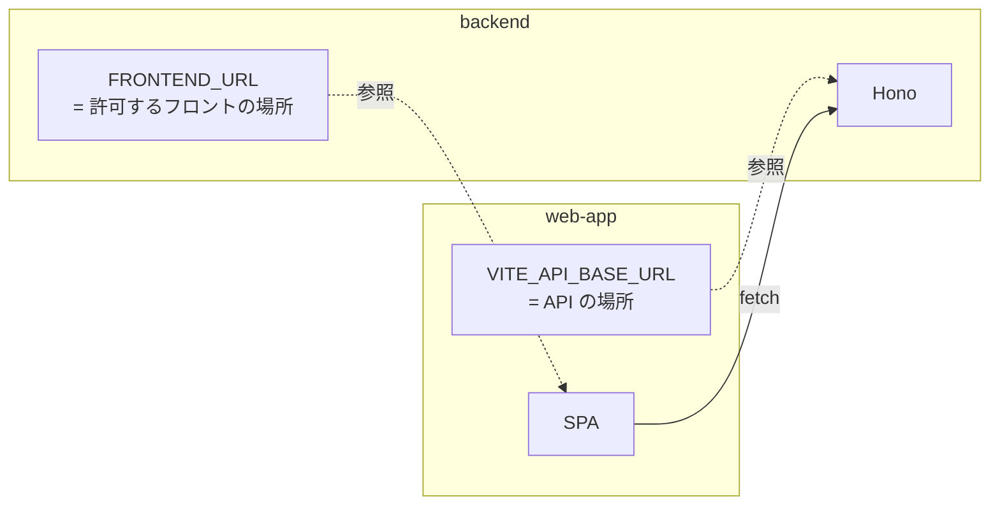

# 設定の外部化 — 環境変数で URL を切り替える

## 概要

「API サーバーの URL」や「CORS で許可するフロントの URL」は、開発環境・本番環境で値が変わります。これらをコードに直接書かず、**環境変数（`.env` ファイル）として外に出す** のが設定の外部化です。

同じコードを、設定だけ変えて別の環境で動かせる —— これはデプロイ可能なアプリを作るうえでの基本原則です（The Twelve-Factor App の「III. 設定」）。

## このプロジェクトでの実装

### 2 つの環境変数

| キー | どこで使う | 意味 |
|---|---|---|
| `FRONTEND_URL` | `backend/.env` → `backend/src/env.ts:9` → `backend/src/index.ts:11` | CORS で許可するオリジン（フロントの URL） |
| `VITE_API_BASE_URL` | `web-app/.env` → 各フックの `:3` | フロントが呼び出す API のベース URL |

2 つは **お互いを指し合う** 関係です。



### バックエンド: 起動時に検証する

```ts
// backend/src/env.ts:1-12
import { createEnv } from "@t3-oss/env-core";
import z from "zod";
import dotenv from "dotenv";

dotenv.config();                       // .env を process.env に読み込む

export const env = createEnv({
  server: {
    FRONTEND_URL: z.string(),          // 文字列であることを要求
  },
  runtimeEnv: process.env,
});
```

```ts
// backend/src/index.ts:10-11
cors({
  origin: [env.FRONTEND_URL],
```

`process.env.FRONTEND_URL` を直接使わず、**検証済みの `env` オブジェクト経由** で使うのがポイントです。設定が欠けていればサーバー起動時にエラーで止まるので、「動いているように見えて CORS だけ失敗する」といった分かりにくい不具合を防げます（ライブラリの詳細は Tooling / TypeScript フォルダ参照）。

### フロントエンド: ビルド時に埋め込まれる

```ts
// web-app/src/hooks/useIncomeTransactions.ts:3（他の 2 フックも同じ）
const BASE_URL = import.meta.env.VITE_API_BASE_URL;
```

Vite は `VITE_` で始まる変数だけをクライアントのコードに公開し、ビルド時に値を **埋め込み** ます（Tooling フォルダ参照）。

## 重要語句

- **環境変数**: OS やプロセスに渡される key=value の設定値。
- **`.env` ファイル**: 環境変数をファイルで定義する慣習。dotenv や Vite が読み込む。
- **設定の外部化**: 環境ごとに変わる値をコードの外に出すこと。
- **The Twelve-Factor App**: クラウド時代のアプリ設計の 12 原則。「設定は環境変数に格納する」を含む。
- **フェイルファスト（fail fast）**: 問題があれば早い段階（起動時）ではっきり失敗させる設計。
- **ビルド時変数 / 実行時変数**: フロントの `VITE_*` はビルド時に固定、バックエンドの `process.env` は起動時に読まれる。

## 仕様・注意点

- **フロントの環境変数は秘密にできない**: `VITE_` 変数はビルド後の JS に文字列として含まれ、誰でも見られます。API キーなどの秘密情報を入れてはいけません。URL は公開されても問題ない値です。
- **フロントの値は起動時ではなくビルド時に決まる**: 本番の API URL を変えるには再ビルドが必要です。
- **フロント側には検証がない**: `VITE_API_BASE_URL` が未設定だと `BASE_URL` は `undefined` になり、`fetch("undefined/transactions?...")` という **相対 URL** へのリクエストになって失敗します。エラーメッセージからは原因が分かりにくいです。
- **型の補完**: `import.meta.env.VITE_API_BASE_URL` の型は `vite/client` の既定の型定義（`tsconfig.app.json:7`）によるもので、このプロジェクトでは `vite-env.d.ts` 等で独自に型付けしていません（TypeScript / Tooling フォルダ参照）。
- **バックエンドの検証は「文字列であること」だけ**: `z.string()` は空文字も通します。`z.url()` にすると URL 形式も保証できます。
- **ポート番号はハードコード**: バックエンドの `port: 3000`（`backend/src/index.ts:89`）は環境変数化されていません。多くのホスティングは `PORT` 環境変数でポートを指定するため、本番デプロイ時には外部化が必要になります。
- **`.env` の扱い**: 当初は `backend/.gitignore` でしか `.env` を除外していませんでしたが、2026-10-12 に修正済みで、現在は `backend/.gitignore:18` と `web-app/.gitignore:16` の両方で除外されています。チームで共有するなら値の入っていない `.env.example` をコミットし、実際の `.env` は各自で作る運用が一般的です。

## 今後に活かせるポイント

- 環境ごとに変わる値（URL、ポート、DB 接続文字列、API キー）は最初から環境変数にする。
- 環境変数は **アプリの入口で 1 回だけ読み、検証し、型付きのオブジェクトとして配る**（このプロジェクトの `env.ts` の形）。コードのあちこちで `process.env.XXX` を直接読まない。
- フロントとバックで「秘密にできる / できない」の違いを常に意識する。

## 改善するなら

### フロントにも env モジュールを作る

```ts
// web-app/src/env.ts（案）
const apiBaseUrl = import.meta.env.VITE_API_BASE_URL;
if (!apiBaseUrl) {
  throw new Error("VITE_API_BASE_URL が設定されていません。web-app/.env を確認してください。");
}
export const env = { apiBaseUrl } as const;
```

各フックの `const BASE_URL = import.meta.env.VITE_API_BASE_URL;` を `env.apiBaseUrl` に置き換えれば、読み込み箇所が 1 つになります（`@t3-oss/env-core` の `client` / `clientPrefix` オプションを使う方法もある）。

### バックエンドの検証を強化しポートも外部化

```ts
// backend/src/env.ts（案）
export const env = createEnv({
  server: {
    FRONTEND_URL: z.url(),
    PORT: z.coerce.number().default(3000),
  },
  runtimeEnv: process.env,
});
```

### サンプルファイルを用意

```text
backend/.env.example     FRONTEND_URL=
web-app/.env.example     VITE_API_BASE_URL=
```

## 次に学ぶこと

- **The Twelve-Factor App**（特に III. Config）。
- **Vite のモードと `.env.[mode]`**（`.env.development` / `.env.production`）による環境別設定（Tooling フォルダ参照）。
- **シークレット管理**: 本番ではホスティングサービスの環境変数設定や Secret Manager を使う。
