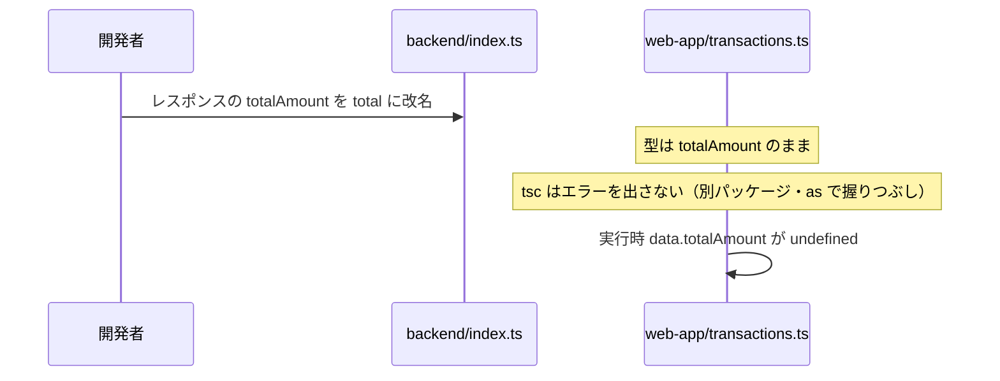

# API 契約と型の二重管理問題

## 概要

フロントとバックを分離すると、「API がどんな JSON を受け取り、返すか」という **契約** を両者で共有する必要があります。このプロジェクトでは、同じ「取引」の形が **3 か所に別々に書かれて** おり、どれも自動では同期されません。

1. `backend/openapi.yaml` … 人間向けの仕様書
2. `backend/src/index.ts` … 実際の実装（型注釈なし、オブジェクトリテラル）
3. `web-app/src/hooks/transactions.ts` … フロントの TypeScript 型

これが **二重管理（多重管理）問題** です。どれか 1 つを変えて他を直し忘れても、コンパイルは通り、実行時に初めて壊れます。

## このプロジェクトでの実装

### 同じ「取引」が 3 か所に

```yaml
# backend/openapi.yaml:120-131
Transaction:
  allOf:
    - type: object
      required: [id]
      properties:
        id: { type: integer }
    - $ref: "#/components/schemas/TransactionInput"   # item, amount, date
```

```ts
// backend/src/index.ts:30-37 — 型はなく、値から推論されるだけ
const transactionList = [
  { id: 1, item: "給料", amount: 10000, date: "2025-01-01" },
];
```

```ts
// web-app/src/hooks/transactions.ts:1-12
export type Transaction = { id: number; item: string; amount: number; date: string };
export type TransactionListInfo = { transactions: Transaction[]; totalCount: number; totalAmount: number };
```

### 境界でのつなぎ目は「型アサーション」

```ts
// web-app/src/hooks/useIncomeTransactions.ts:19
const data = (await response.json()) as TransactionListInfo;
```

`response.json()` の戻り値は型がわからない（`any`）ため、`as` で「この形のはず」と宣言しているだけです。実行時の検証はありません。

### ずれが起きた場合のシナリオ



## 重要語句

- **API 契約（contract）**: クライアントとサーバーが合意したリクエスト/レスポンスの形。
- **OpenAPI**: REST API の仕様を YAML/JSON で記述する標準形式（API-Design フォルダ参照）。
- **型アサーション（`as`）**: 型チェッカーに「この型として扱え」と指示する構文。実行時には何もしない。
- **ランタイム検証**: 実行時に実際の値が期待する形かを確認すること（Zod の `parse` など）。
- **スキーマ駆動開発（Schema-first）**: 仕様（スキーマ）を先に書き、そこから型・コード・ドキュメントを生成する進め方。
- **コード駆動（Code-first）**: 実装（コード）を正とし、そこから仕様書や型を生成する進め方。
- **Single Source of Truth**: 情報の正本を 1 つにすること。

## 仕様・注意点

- 現状は OpenAPI と実装・フロントの型の **内容はおおむね一致** しています（`id` の有無、`totalCount` / `totalAmount` など）。問題は「今一致している」ことではなく「**ずれても気づく仕組みがない**」ことです。
- 細かな差異の例:
  - OpenAPI の `id` は `integer`、フロントの型は `number`（TypeScript には整数型がないため避けられない差）。
  - OpenAPI の `date` は `format: date`、フロントの型はただの `string`。
  - OpenAPI の `type` クエリは `enum: [income, expense, all]` だが、フロントには対応する型がなく、URL 文字列にハードコード（`useIncomeTransactions.ts:15`）。
- バックエンドとフロントが別パッケージなので、TypeScript の型を `import` で共有することも今の構成ではできません（`03-repository-structure.md`）。

## 今後に活かせるポイント

二重管理を解消する代表的な 3 つの方向性があり、プロジェクトの性質で選びます。

| 方式 | 正本 | 仕組み | 向いている状況 |
|---|---|---|---|
| **A. スキーマ駆動（OpenAPI → 型生成）** | `openapi.yaml` | `openapi-typescript` などで TS 型やクライアントを生成 | 言語が違うチーム、外部公開 API、仕様を先に合意したい |
| **B. コード駆動（Zod → OpenAPI 生成）** | Zod スキーマ | `@hono/zod-openapi` などでスキーマから検証 + OpenAPI を生成 | バックエンドが TS、仕様書も欲しい |
| **C. 型共有（Hono RPC）** | バックエンドのコード | `hc<AppType>()` でルート定義から型付きクライアントを得る | フロントもバックも TS で、同じリポジトリ（モノレポ）にある |

どの方式でも、**境界（`response.json()` の直後）でランタイム検証を入れる** と、型と実データのずれを実行時に確実に検知できます。

## 改善するなら

### 今すぐできる: フロントでランタイム検証

```ts
// web-app（案）: zod を web-app にも追加した場合
import { z } from "zod";

const transactionSchema = z.object({
  id: z.number().int(),
  item: z.string(),
  amount: z.number(),
  date: z.string(),
});
const transactionListSchema = z.object({
  transactions: z.array(transactionSchema),
  totalCount: z.number().int(),
  totalAmount: z.number(),
});
export type TransactionListInfo = z.infer<typeof transactionListSchema>; // 型はスキーマから導出

const data = transactionListSchema.parse(await response.json()); // as を使わない
```

### 方式 A の例: OpenAPI から型を生成

```bash
npx openapi-typescript ../backend/openapi.yaml -o src/api/schema.d.ts
```

```ts
import type { components } from "./api/schema";
type Transaction = components["schemas"]["Transaction"];
```

### 方式 C の例: Hono RPC（モノレポ化が前提）

```ts
// backend: ルートをチェーンで定義し型を export
const route = app.get("/transactions", (c) => c.json(result, 200));
export type AppType = typeof route;

// web-app
import { hc } from "hono/client";
import type { AppType } from "@kakeibo/backend";
const client = hc<AppType>(env.apiBaseUrl);
const res = await client.transactions.$get({ query: { type: "income" } });
```

詳細は Hono / API-Design フォルダ参照。

## 次に学ぶこと

- **openapi-typescript / openapi-fetch**: OpenAPI から型と型安全な fetch クライアントを得る。
- **Hono RPC** と **@hono/zod-openapi**。
- **tRPC / GraphQL**: 別の型共有アプローチ。
- **契約テスト（Contract Testing）**: 実装が仕様に従っているかを自動テストで確認する（Pact、Schemathesis など）。
