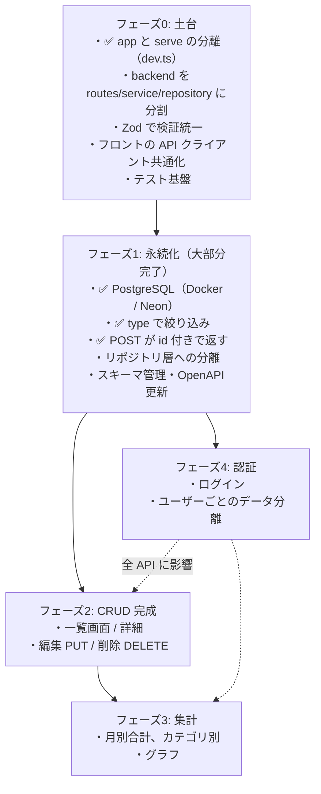

# 今後の拡張ロードマップ — 設計の観点から

## 概要

ここまでのノートで見てきた課題を踏まえ、家計簿アプリに機能を足していくとき **どの順番で、どの構造変更を伴うか** を整理します。機能そのものより「その機能を入れると、どの層に何が増えるか」に注目するのがポイントです。

## このプロジェクトでの実装

### 現在地

| 項目 | 現状 | 関連ノート |
|---|---|---|
| 画面 | Home（直近 3 件 × 収入/支出）、Input（登録） | `05` |
| API | `GET /transactions?type=`、`POST /transactions` | `04` |
| 永続化 | PostgreSQL（ローカル: Docker / 本番: Neon）。SQL はハンドラに直書き | `15` |
| 認証 | なし（`backend/openapi.yaml:12` `security: []`） | — |
| 型共有 | なし（手動で同期）。POST 201 の OpenAPI が実装とずれている | `14` |
| テスト | なし | `16` |
| デプロイ | web-app（+ 学習ノート `/study/`）と backend を Vercel、DB は Neon | `01`, `../PostgreSQL/08-neon-and-vercel-attach-database-pool.md` |

CORS 設定には将来を見越した項目が既に入っています。

```ts
// backend/src/index.ts:16-18
allowMethods: ["GET", "POST", "PUT", "DELETE", "OPTIONS"],  // 編集・削除を想定
allowHeaders: ["Content-Type", "Authorization"],            // 認証ヘッダーを想定
credentials: true,                                          // Cookie 認証を想定
```

現状 `PUT` / `DELETE` のルートは存在せず、フロントの fetch も `credentials` オプションを指定していないので、これらは **まだ使われていない準備段階の設定** です。

## 重要語句

- **ロードマップ**: 機能追加の順序と依存関係を示した計画。
- **技術的負債**: 速さを優先した結果、後で手直しが必要になった設計上の借り。
- **リソース指向 / CRUD**: Create・Read・Update・Delete の 4 操作をリソース（URL）に対して行う API 設計（API-Design フォルダ参照）。
- **認証（Authentication）/ 認可（Authorization）**: 「誰か」を確かめること / 「その人に許されているか」を確かめること。
- **マルチテナント**: 1 つのシステムで複数ユーザー（組織）のデータを分離して扱うこと。

## 仕様・注意点

機能を足す前に土台を固める順番が重要です。依存関係を図にすると次のようになります。



認証は全 API・全データに影響する（「誰のデータか」という列が全テーブルに入る）ため、**後回しにするほど改修範囲が広がります**。本格運用を考えるなら、永続化の直後に入れるのがおすすめです。

### 実際の進み方（2026-10-14 時点）

計画ではフェーズ 0（土台）→ フェーズ 1（永続化）の順でしたが、実際は **フェーズ 1 の DB 導入を先に行い**、フェーズ 0 の分割は「`app` と `serve` の分離」だけが Vercel 対応のついでに実現しました（コミット `2a1609f`）。その結果、SQL がハンドラに直接書かれた状態になっています。

フェーズ 1 の残りとして、次を片付けてからフェーズ 2 に進むと楽です。

1. SQL をリポジトリ層に移す（`15-persistence-and-repository-layer.md`）
2. backend の検証を DB の型・制約に揃え、入力ミスで 500 にならないようにする（`12-validation-layers.md`）
3. OpenAPI の 201 を `Transaction` に直す（`14-api-contract-and-types.md`）
4. テーブル定義を `schema.sql` / マイグレーションでリポジトリに置き、ローカル（Docker）と本番（Neon）を揃える（`../Database/04-migrations-and-schema-management.md`）

## 今後に活かせるポイント

### 各機能が各層に与える影響

| 機能 | バックエンド | フロントエンド | 契約（OpenAPI） | データモデル |
|---|---|---|---|---|
| 永続化（実施済み） | DB 接続 + SQL（**repository はまだ**） | 変更なし（フロントの `Transaction` 型は元々 `id` を持っていた） | 201 に `id` 追加（**OpenAPI は未更新**） | `transactions` テーブル作成（psql で手作業） |
| 編集・削除 | `PUT/DELETE /transactions/:id` | 一覧・編集画面、`useUpdate/useDelete` フック、キャッシュ更新 | パス追加 | 変更なし |
| 全件一覧・ページング | `LIMIT` / `OFFSET`（またはカーソル）。並び順は `ORDER BY date DESC` 済み、`id` での同順位の決定が必要 | 一覧ページ、ルート追加 | クエリパラメータ追加 | `date` のインデックス（`../Database/02-keys-and-indexes.md`） |
| 月別・カテゴリ集計 | 集計 API（`GET /summary?month=`）。SQL の `GROUP BY` / `SUM` で計算（`../SQL/09-aggregate-functions-and-group-by.md`） | グラフ、月切替（URL で状態管理） | スキーマ追加 | `category` 列、`type` 列（`09` の案 B）|
| 認証 | 認証ミドルウェア、全クエリに `user_id` 条件 | ログイン画面、保護ルート、`credentials: "include"` | `security` 定義 | `users` テーブル、`transactions.user_id` 外部キー（既存データの扱いを決めるマイグレーションが必要） |

### 設計上の判断ポイント

- **編集・削除** を入れると「一覧の state を更新する」必要が増え、現在の「画面遷移で取り直す」方式（`10-state-management.md`）では足りなくなる場面が出てきます。TanStack Query 導入の良いタイミングです。
- **集計** は「サーバーで計算して返す」か「全件を返してフロントで計算する」か。件数が増えるならサーバー（DB）側が有利。今の `totalAmount` はサーバー計算方式ですが、DB から全行を取ってきて TypeScript の `reduce` で足しています（`backend/src/index.ts:63-66`）。月別・カテゴリ別の集計では SQL の `SUM` / `GROUP BY` に任せる方が効率的です。
- **直近 N 件** は今フロントで `slice` していますが（`TransactionList.tsx:102-105`）、API は全件を返しています。並び順（`date` 降順）は SQL 側で付いたので、データが増えたら API に `limit` を持たせ、SQL の `LIMIT` で必要な件数だけ取るべきです。ただし `totalCount` / `totalAmount` は全件に対する値なので、`LIMIT` とは別に集計する必要があります。
- **カテゴリ** を足すなら、符号表現をやめて `type` を明示するモデル（`09` の案 B）へ移行する好機です。
- **認証方式** は Cookie（セッション）か Bearer トークンか。CORS の `credentials: true` は Cookie 方式向けの準備です。Cookie 方式でクロスオリジンにする場合は `SameSite` 属性などの考慮も必要になります。

## 改善するなら

フェーズ 2 まで進んだときのディレクトリ構成イメージです。

```text
backend/src/
├── index.ts                  ← Pool を作り app を export（Vercel のエントリ）
├── dev.ts                    ← ローカル起動の serve（実施済み）
├── app.ts                    ← ミドルウェア + ルートのマウント + onError
├── env.ts
├── middleware/
│   └── auth.ts               ← フェーズ4
├── routes/
│   ├── transactions.ts       ← GET / POST / PUT /:id / DELETE /:id
│   └── summary.ts            ← フェーズ3
├── schemas/transaction.ts
├── services/transactionService.ts
├── repositories/             ← transactionRepository（interface）+ pg 実装
└── db/
    └── migrations/           ← テーブル定義の変更履歴

web-app/src/
├── main.tsx / App.tsx
├── lib/apiClient.ts          ← BASE_URL、エラー変換
├── features/
│   └── transactions/
│       ├── api.ts
│       ├── types.ts
│       ├── hooks/            ← useTransactions, useAddTransaction, useUpdate..., useDelete...
│       └── components/       ← TransactionList, TransactionForm（登録と編集で共用）
├── components/Header.tsx
└── pages/
    ├── Home.tsx
    ├── Input.tsx             ← TransactionForm を使用
    ├── Transactions.tsx      ← 全件一覧
    └── EditTransaction.tsx   ← /transactions/:id/edit
```

登録フォームと編集フォームは見た目がほぼ同じなので、Input.tsx のフォーム部分を `TransactionForm`（初期値と送信関数を props で受け取る Presentational）として切り出すと再利用できます。

## 次に学ぶこと

- **ADR（Architecture Decision Record）**: 「なぜこの設計にしたか」を短い文書で残す習慣。このノートの「改善するなら」を実行に移すときに有用。
- **認証の基礎**: セッション Cookie と JWT の違い、Better Auth / Auth.js などのライブラリ。
- **クリーンアーキテクチャ**: 機能が増えても依存の向きを保つための考え方。
