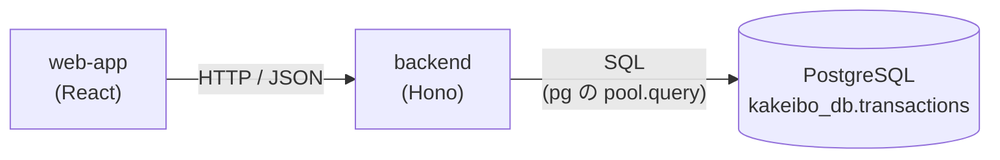

# データベースとは何か（DBMS・RDB・テーブル）

## 概要

データベース（DB）は、データを **整理して保存し、あとから検索・更新できるようにする仕組み** です。実際にデータを管理するソフトウェアを **DBMS（データベース管理システム）** と呼び、このプロジェクトで使っている PostgreSQL は DBMS の 1 つです。

家計簿アプリは最初、API がハンドラ内の固定データを返すだけで、何も保存していませんでした。現在は PostgreSQL の `transactions` テーブルに保存し、そこから読み出す形になっています（コードの構造と改善案は `../Architecture/15-persistence-and-repository-layer.md`）。

## このプロジェクトでの実装



- 登録：`POST /transactions` → `INSERT INTO transactions ...`（`backend/src/index.ts:93-96`）
- 一覧：`GET /transactions?type=...` → `SELECT ... FROM transactions ...`（`backend/src/index.ts:41-54`）

backend のプロセスが再起動しても、データは PostgreSQL 側（Docker のボリューム、本番は Neon）に残ります。

## 重要語句

| 用語 | 意味 | このプロジェクトでは |
| --- | --- | --- |
| **DBMS** | DB を管理するソフト。保存・検索・同時アクセス制御・障害からの復旧などを担当 | PostgreSQL 18.3 |
| **RDB（リレーショナルデータベース）** | データを **表（テーブル）** の形で持ち、SQL で操作する DB | PostgreSQL は RDB |
| **データベース** | テーブルなどをまとめた単位。1 つの PostgreSQL の中に複数作れる | `kakeibo_db`（他に `postgres` など） |
| **スキーマ** | DB の中でテーブルをまとめる名前空間。既定は `public` | `public.transactions` |
| **テーブル** | 同じ形のデータの集まり（表） | `transactions` |
| **行（row / レコード）** | テーブルの 1 件分のデータ | 1 件の収支 |
| **列（column / カラム）** | データの項目。名前と型を持つ | `id` / `item` / `amount` / `date` |
| **SQL** | RDB を操作するための言語 | `../SQL/` を参照 |

※「スキーマ」という言葉は、上の「名前空間」の意味のほかに、「テーブル定義（どんな列・型・制約があるか）」という意味でも使われます（→ 03）。

### 階層構造

```text
PostgreSQL サーバー（Docker の kakeibo-postgres / 本番は Neon）
└── データベース kakeibo_db
    └── スキーマ public
        └── テーブル transactions
            ├── 列: id, item, amount, date
            └── 行: (1, おこづかい, 30000, 2025-10-01), ...
```

学習メモの `\dt` の結果に `Schema = public` と出ていたのは、この階層の「スキーマ」です。

## なぜメモリ（変数・配列）ではなく DB に保存するのか

| 観点 | JS の配列に保存 | DB に保存 |
| --- | --- | --- |
| 再起動 | プロセスが終わると **消える** | 残る |
| 複数のサーバー | サーバーごとに別々の配列になる（Vercel では関数のインスタンスが複数できる） | 全インスタンスが同じ DB を見る |
| 検索・集計 | 自分でループを書く | `WHERE` / `ORDER BY` / `SUM` で DB に任せられる |
| 同時アクセス | 自分で排他制御を考える必要がある | DBMS がトランザクションで面倒を見る（→ `../SQL/10-transactions-commit-rollback.md`） |
| データの正しさ | 型チェックは TypeScript 上だけ | 型・NOT NULL・長さなどの **制約** を DB が強制する |

特に Vercel のようなサーバーレス環境では、関数のインスタンスが必要に応じて作られては破棄されるため、**メモリに保存したデータはいつ消えてもおかしくありません**。外部の DB に保存するのが必須です。

## 仕様・注意点

- **RDB 以外の DB もある**：キー・バリュー型（Redis）、ドキュメント型（MongoDB）など、まとめて NoSQL と呼ばれます。家計簿のように「同じ形のデータを集計する」用途には RDB が向いています。
- **DB はアプリとは別のサーバー（プロセス）**：backend は DB にネットワーク越しに SQL を送って結果を受け取ります。だから接続先（`DATABASE_URL`）の設定や、接続数の管理（コネクションプール）が必要になります（→ `../PostgreSQL/06-node-postgres-pool-and-query.md`）。

## 今後に活かせるポイント

- 「データの置き場所」と「データを使う処理」を分けて考える。DB は置き場所の専門家で、検索・集計・整合性の維持を得意とする。
- 何を DB にやらせ、何をアプリ（TypeScript）でやるかは設計の判断。例えば現在の合計金額はアプリ側の `reduce`（`backend/src/index.ts:63-66`）で計算していますが、SQL の `SUM()` で DB に計算させることもできます（→ `../SQL/09-aggregate-functions-and-group-by.md`）。

## 次に学ぶこと

- 主キーとインデックス（→ 02）
- 家計簿のテーブル設計を見直す（→ 03）
