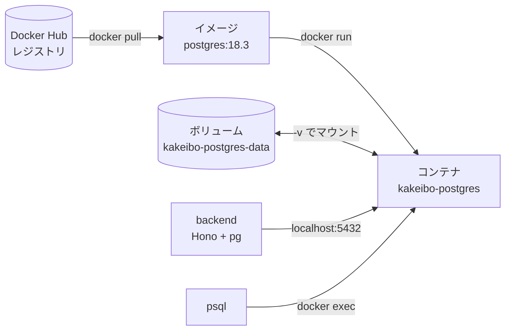

# Docker とは何か（イメージ・コンテナ・レジストリ）

## 概要

Docker は、アプリケーションとその実行に必要なもの（OS のライブラリ、設定、バイナリ）をひとまとめにして、**どの PC でも同じように動かす** ための仕組みです。

家計簿アプリでは、ローカル開発用の **PostgreSQL を Docker で動かしています**。Mac に PostgreSQL を直接インストールしなくても、コマンド 1 つで「PostgreSQL 18.3 が入った環境」を起動・破棄できます。

## このプロジェクトでの使い方

学習メモで実行したコマンドの流れ：

```bash
docker pull postgres:18.3                                  # ① イメージを取得（→ 02）
docker run --name kakeibo-postgres \                       # ② コンテナを作成・起動（→ 03〜05）
  -e POSTGRES_PASSWORD=mysecretpassword \
  -p 5432:5432 \
  -v kakeibo-postgres-data:/var/lib/postgresql \
  -d postgres:18.3
docker ps                                                  # ③ 起動中のコンテナを確認（→ 06）
docker exec -it kakeibo-postgres psql -U postgres          # ④ コンテナ内で psql を実行（→ 07）
docker exec -it kakeibo-postgres psql -U postgres -d kakeibo_db
```

※ 学習メモでは 1 行で書いていますが、見やすさのため `\` で改行しています（シェル上の意味は同じ）。

全体像：



## 重要語句

| 用語 | 意味 | このプロジェクトでは |
| --- | --- | --- |
| **イメージ（image）** | コンテナの「元になる読み取り専用のテンプレート」。OS のファイル群 + アプリ + 既定の設定 | `postgres:18.3` |
| **コンテナ（container）** | イメージから作られた「実行中（または停止中）の環境」。1 つのイメージから何個でも作れる | `kakeibo-postgres` |
| **レジストリ（registry）** | イメージの配布場所。既定は Docker Hub | Docker Hub の公式 `postgres` イメージ |
| **タグ（tag）** | イメージのバージョン名。`名前:タグ` の形 | `18.3` |
| **ボリューム（volume）** | コンテナの外で管理される永続的な保存領域 | `kakeibo-postgres-data`（→ 04） |
| **Docker Desktop** | Mac / Windows で Docker を動かすアプリ。内部で Linux の仮想マシンを動かしている | このPC の Docker 29.1.3 |

### イメージとコンテナの関係

クラスとインスタンスの関係に似ています。

- イメージ ＝ 設計図（変更されない）
- コンテナ ＝ 設計図から作った実体（中でファイルが書き換わる）

コンテナを削除すると、その中で書き換わったファイルは消えます。だから DB のデータは **ボリューム** に置きます（→ 04）。

## 仕様・注意点

- **Mac では Linux 仮想マシンの中で動いている**: `postgres` イメージは Linux 用です。Docker Desktop が裏で Linux VM を動かし、その中でコンテナを実行しています。実際このPC では `docker image inspect` の結果が `arm64 linux`（Apple Silicon 向けの Linux イメージ）でした。
- **コンテナは仮想マシンではない**: コンテナはホスト（ここでは Docker Desktop の Linux VM）のカーネルを共有し、プロセスを隔離しているだけです。そのため VM より起動が速く軽量です。
- **Docker Desktop が起動していないと何もできない**: `docker` コマンドは Docker Desktop（Docker エンジン）に指示を送るだけのクライアントです。

## なぜ DB を Docker で動かすのか

| 方法 | 長所 | 短所 |
| --- | --- | --- |
| Mac に直接インストール（Homebrew など） | Docker 不要 | バージョン切り替え・削除が面倒、他プロジェクトと干渉しやすい |
| **Docker で動かす（今回）** | バージョンをタグで固定、プロジェクトごとに分離、不要になったら消すだけ | Docker Desktop が必要、ボリュームなどの概念を覚える必要がある |
| クラウド DB（Neon など） | 本番と同じ環境、PC に何も入れない | ネット接続が必要、無料枠の制限、開発中の雑な操作が共有 DB に影響 |

このプロジェクトは本番（Vercel）では Neon の PostgreSQL を使う構成です（コミット `2a1609f`）。ローカルでは Docker の PostgreSQL で開発し、本番は Neon、という分担が自然です（→ 08、`../PostgreSQL/08-neon-and-vercel-attach-database-pool.md`）。

## 今後に活かせるポイント

- 「DB・キャッシュ（Redis）・メールサーバー」など、アプリ本体以外の **周辺ミドルウェアを Docker で動かす** のは開発現場でとても一般的です。
- イメージのタグでバージョンを固定すれば、チーム全員が同じバージョンの DB で開発できます。

## 次に学ぶこと

- `docker pull` とタグ（→ 02）
- `docker run` の各オプション（→ 03）
- 複数コンテナや長いオプションをファイルで管理する **Docker Compose**（`compose.yaml`）
