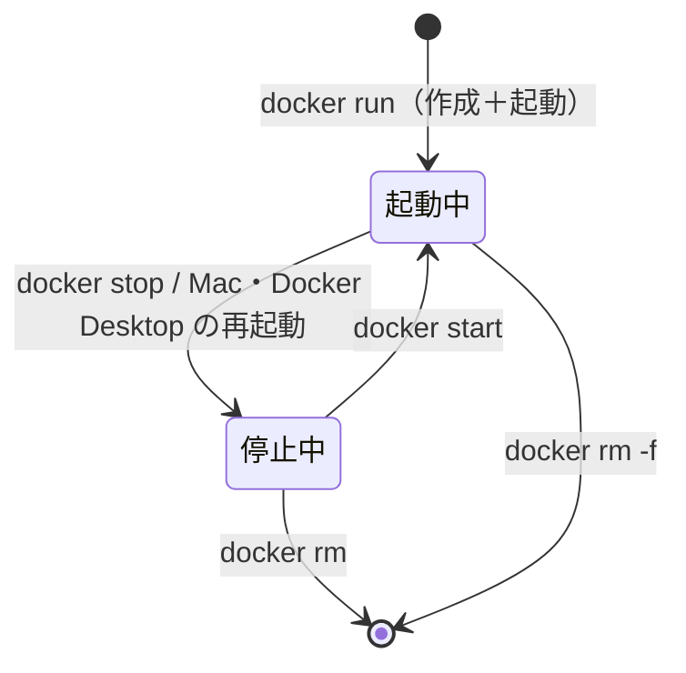

# コンテナの起動・停止・削除と、よくあるエラー

## 概要

コンテナには「作成 → 起動 → 停止 → 削除」というライフサイクルがあります。`docker run` は「作成＋起動」を一度に行うコマンドなので、**2 回目以降は `docker start` を使う** のがポイントです。



## このプロジェクトでの実装

学習メモでは `docker ps` で起動を確認しています。

```bash
docker ps
```

```text
CONTAINER ID   IMAGE           COMMAND                  CREATED        STATUS        PORTS                                         NAMES
6053b0a9d255   postgres:18.3   "docker-entrypoint.s…"   12 hours ago   Up 12 hours   0.0.0.0:5432->5432/tcp, [::]:5432->5432/tcp   kakeibo-postgres
```

## よく使うコマンド

| コマンド | 意味 |
| --- | --- |
| `docker ps` | **起動中** のコンテナ一覧 |
| `docker ps -a` | 停止中も含めた **すべて** のコンテナ一覧 |
| `docker stop kakeibo-postgres` | 停止する（PostgreSQL に終了シグナルを送り、安全に止める） |
| `docker start kakeibo-postgres` | 停止中のコンテナを起動する（設定・データはそのまま） |
| `docker restart kakeibo-postgres` | 停止 → 起動 |
| `docker logs kakeibo-postgres` | ログを表示（`-f` で追い続ける、`--tail 50` で末尾だけ） |
| `docker rm kakeibo-postgres` | 停止中のコンテナを削除（`-f` で起動中でも強制削除） |
| `docker inspect kakeibo-postgres` | 設定の詳細（マウント・環境変数・ポートなど）を JSON で表示 |

`docker rm` してもボリュームは残るので、同じ `-v` で `docker run` し直せばデータは戻ります（→ 04 の実験）。

## 実験：よくあるエラー

### 1. 同じ名前で `docker run` した

```text
docker: Error response from daemon: Conflict. The container name "/study-pg" is already in use by container "f56a780d...". You have to remove (or rename) that container to be able to reuse that name.
```

**原因**：同名のコンテナ（停止中でも）が残っている。
**対処**：単に起動したいなら `docker start 名前`。設定を変えて作り直したいなら `docker rm 名前` してから `docker run`。

### 2. ポートがすでに使われている

```text
docker: Error response from daemon: failed to set up container networking: driver failed programming external connectivity on endpoint study-pg2 (...): Bind for 0.0.0.0:5433 failed: port is already allocated
```

**原因**：ホスト側のポートを別のコンテナ（またはMac で動いている別の PostgreSQL など）が使っている。
**対処**：使っている方を止めるか、`-p 5434:5432` のようにホスト側のポートを変える。
**注意**：このエラーのときも **コンテナ自体は作成されている**（起動に失敗しただけ）ので、`docker ps -a` に残ります。続けて同じ名前で `docker run` すると 1 のエラーになるため、`docker rm` で消してからやり直します。

### 3. 起動したのにすぐ止まる

`docker ps` に出てこず、`docker ps -a` で `Exited (1)` になっているときは、`docker logs 名前` を見ます。今回の実験では次の 2 つが原因でした。

- `POSTGRES_PASSWORD` を指定していない（→ 05）
- PostgreSQL 18 で `/var/lib/postgresql/data` にマウントした（→ 04）

### 4. Mac を再起動したら backend が DB につながらない

今回のコンテナは再起動ポリシーが `no`（`docker inspect` で確認）なので、Docker Desktop を起動し直してもコンテナは停止したままです。

```bash
docker start kakeibo-postgres
```

で起動します。backend 側では接続拒否（`ECONNREFUSED`）のエラーになります。

## 仕様・注意点

- `docker stop` は既定で 10 秒待っても終わらなければ強制終了します。PostgreSQL は終了シグナルを受けると安全にシャットダウンするので、通常は `docker stop` で問題ありません。いきなり `docker rm -f` で止めると、次回起動時にクラッシュリカバリ（ログからの復旧）が走ることがあります。
- `CONTAINER ID` は名前の代わりに使えます。先頭の数文字（他と区別できる長さ）だけでも指定できます（例：`docker logs 6053`）。

## 今後に活かせるポイント

- 「動かない」ときの確認順：`docker ps -a`（状態）→ `docker logs`（理由）→ `docker inspect`（設定）。
- 開発の始めに「DB コンテナが動いているか」を確認する習慣をつける。backend の README に `docker start kakeibo-postgres` を書いておくと、未来の自分が助かります。

## 次に学ぶこと

- `docker exec` でコンテナ内のコマンドを実行する（→ 07）
- Docker Desktop の GUI でも同じ操作（起動・停止・ログ）ができる
